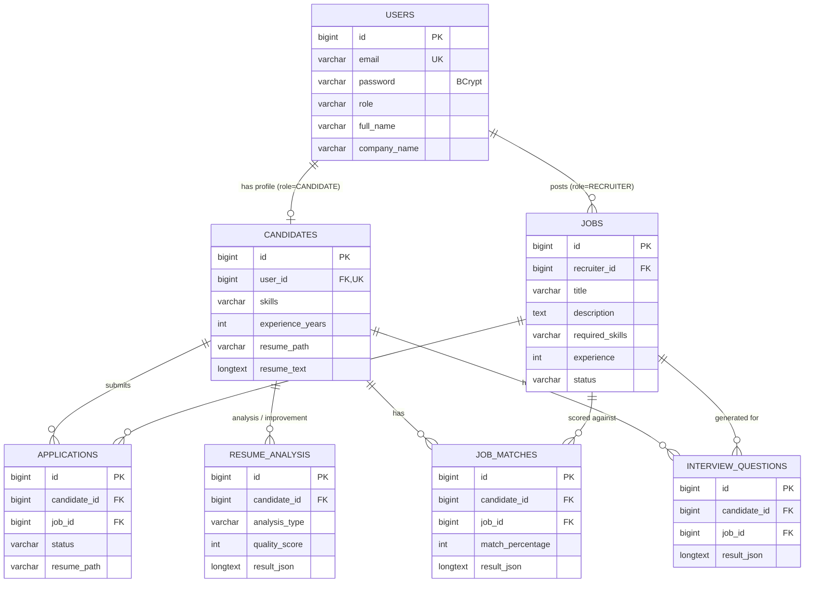

# SmartHire AI - Entity Relationship Diagram

## Notes
- `users.email` is unique. Public registration only creates `CANDIDATE` or `RECRUITER`; `ADMIN` exists in the enum but cannot be self-registered.
- `applications` has a unique pair (`candidate_id`, `job_id`) so a candidate can apply to a job only once.
- Jobs are never hard-deleted by the API: `DELETE /api/jobs/{id}` sets `status = CLOSED` so application history is preserved.
- `resume_analysis.analysis_type` is `ANALYSIS` (quality score + findings) or `IMPROVEMENT` (rewrite suggestions).
- Every table has `created_at`; mutable tables also have `updated_at`.
